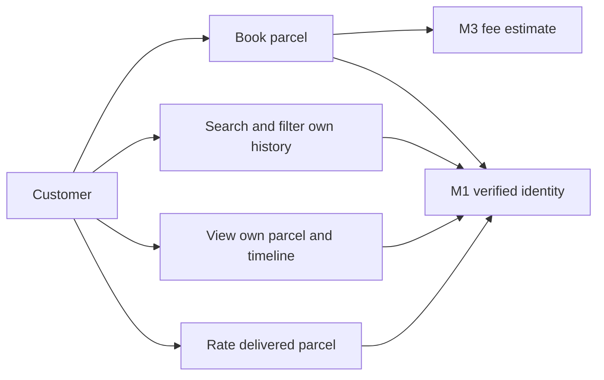
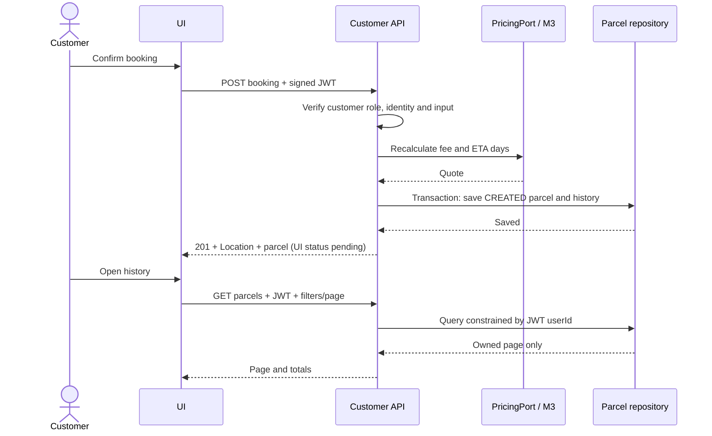

# Customer booking and history backend setup

Work branch: `feature/customer-pages`.

The parcel service uses port 8082. Its default `demo` profile now uses an
ephemeral H2 database and demonstration pricing. The opt-in `neon` profile
enables PostgreSQL configuration from process environment variables without
creating or updating tables (`ddl-auto=none`, SQL initialization disabled).

## Configure the process

Export `PGHOST`, `PGDATABASE`, `PGUSER`, `PGPASSWORD`, `PGSSLMODE` and
`PGCHANNELBINDING` in the terminal or IDE run configuration. Use the team's
connection settings. Never put the password in tracked files, shell command
history, frontend configuration or screenshots. `.env.example` documents the
variable names; Spring Boot does not load a root `.env` automatically.

Set `SPRING_PROFILES_ACTIVE=neon` only for the parcel-service process, then
run `mvn spring-boot:run` from `services/parcel-service` with JDK 21 or a
compatible newer JDK. The project targets Java 21; the machine's default Java
17 cannot compile it.

For development without Neon, explicitly set `SPRING_PROFILES_ACTIVE=demo`
and run the same command. H2 data is lost when the process exits. Never enable
`demo` together with `neon`; use one profile at a time.

Customer endpoints require a valid JWT even in demo mode. Until M1 is integrated,
set a private `JWT_SECRET` of at least 32 UTF-8 bytes and use a token issued by
the team's auth service with HS256, `iss=swiftdrop`, `aud=swiftdrop-api`, `exp`,
`userId` and `role=customer` (or `CUSTOMER`). `name` and `phone` are optional
display claims. Override issuer/audience with `JWT_ISSUER`/`JWT_AUDIENCE`.
Without a key the application starts but rejects bearer tokens. No mock user
header, unsigned token or frontend sender ID is trusted. M1's final signing
algorithm and claims must be agreed before integration.

## Inspect schema before implementing persistence

From the backend repository root, with connection variables exported, run:

```powershell
java --class-path "<absolute-path-to-postgresql-jdbc.jar>" scripts/InspectDatabase.java
```

The inspector requests the password with hidden terminal input if it is not
already provided through the environment. It sets the connection read-only,
queries only table/column metadata, and rolls back. It never reads parcel or
user records and never modifies schema. Connection diagnostics omit credentials.

## Findings and remaining integration work

- The PDF assigns booking, addresses, customer parcel history, ETA and optional
  feedback to M2. Pricing/receipts belong to M3 and authentication/JWT to M1.
- The PDF describes a modular monolith; the checkout has separate service
  applications. Confirm the team's current architecture before integrating.
- Frontend booking/history currently use mocks and localStorage; authentication
  is also mocked. Customer APIs must derive ownership from authenticated identity.
- The gateway already maps a `parcels` entity, with addresses stored as strings.
  Frontend addresses are structured objects. Inspect the live schema before
  deciding the persistence mapping or migrations.
- Agree the status mapping: the document starts at `CREATED`, while the UI uses
  `pending`. Coordinate with dispatcher, courier and tracking owners.
- The initial live schema inspection reached a connection timeout. DNS resolved,
  but no database connection or schema inspection was verified. Confirm endpoint
  availability and port 5432 connectivity before proceeding with migrations.

## Implemented M2 API

See `customer-api.yaml` for the OpenAPI contract. The six endpoints cover fee
preview, booking, paginated/searchable history, owned parcel details, dashboard
counts and feedback after delivery. Booking writes an initial status history row
in the same transaction and creates its own UUID and public tracking number.
Online bookings stay payment-pending; choosing a method does not prove payment.

For isolated development, JPA currently uses `customer_parcels` and
`customer_parcel_history`. These are provisional tables, not the agreed shared
parcel schema. The Neon profile does not create them. Before connecting Neon,
agree the shared parcel mapping with M7/M8/M9 and the gateway, then provide
reviewed Flyway migrations. Do not create a second live source of parcel truth.

`DemoPricing` reproduces the current frontend estimate only in the `demo`
profile. Other profiles use `RemotePricing` and fail with HTTP 503 if pricing is
unavailable; there is no production fallback to fake prices. The proposed M3
contract is POST `/api/v1/pricing/estimate` with the booking payload and response
`{"totalFee":450,"estimatedDays":2}`. This must be agreed with M3; its endpoint
is not implemented in this change. Receipt generation remains M3-owned.

Frontend pages still use localStorage. They have not been switched to this API;
M1 authentication and the shared database contract must be connected first.
Courier status updates, public live tracking and RabbitMQ status events remain
with M8/M9. M2 exposes persisted history but does not claim live push support.

## Test and design

From `services/parcel-service`, with JDK 21 or newer, run `mvn verify`.
This runs tests, builds the service, writes JaCoCo HTML at
`target/site/jacoco/index.html`, and requires at least 70% line coverage for
each of the booking service and two pricing adapters. No coverage gate is
claimed for other members' modules.
The integration tests use H2 and Spring Security test JWTs; an additional case
signs real JWTs to test signature, issuer, audience, expiry and identity checks.
These do not establish PostgreSQL compatibility or Neon connectivity.




