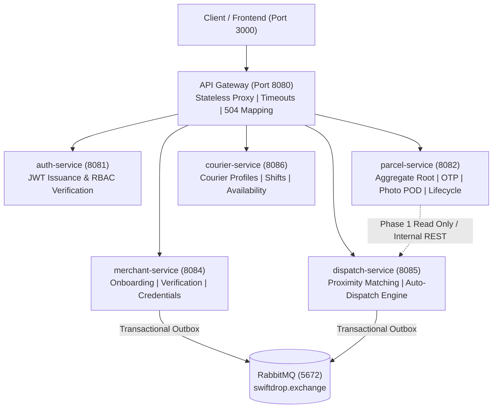
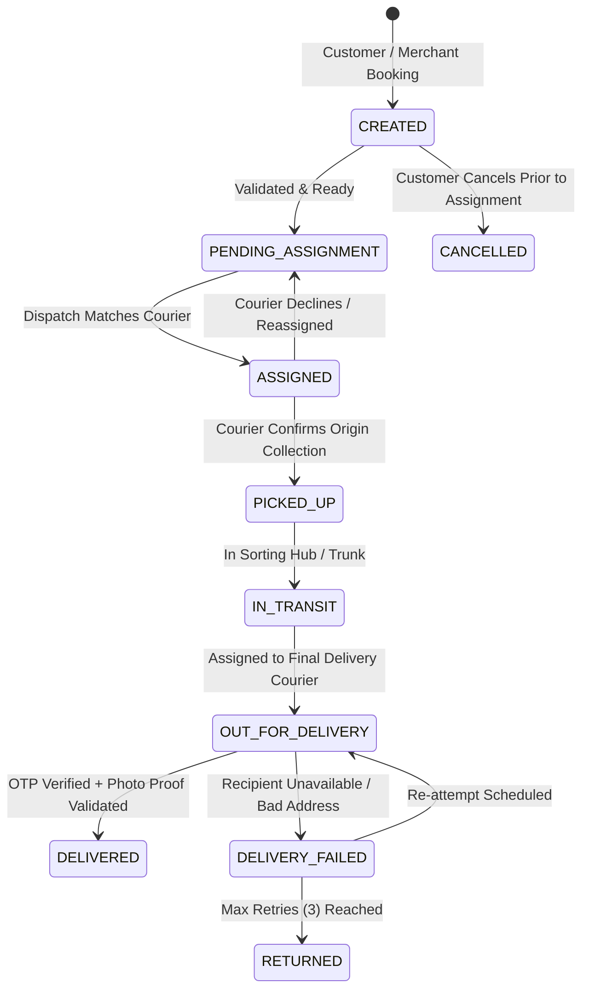

# SwiftDrop — Phase 1: Core Transaction Foundation Specification

**Document ID**: SD-SPEC-01  
**Status**: APPROVED / ACTIVE SPECIFICATION  
**Author**: Principal Software Architect & Lead Full-Stack Systems Engineer  
**Date**: November 22, 2026  
**Scope**: Core Parcel Transaction, Delivery Fulfillment, Courier Operations, Database Integrity, and Frontend Integration  

---

## 1. Existing Architecture & Relevant Services

The SwiftDrop platform is structured as an enterprise distributed microservices architecture utilizing Spring Boot 3, Java 21, PostgreSQL (Neon/local disposable), RabbitMQ, and a React 18 / TypeScript frontend:



### Services Relevant to Phase 1:
1. **`api-gateway` (Port 8080)**: Edge proxy, JWT validation, spoofed header stripping, and timeout resilience.
2. **`auth-service` (Port 8081)**: Authentication token issuance and user identity claims.
3. **`parcel-service` (Port 8082)**: Core domain aggregate root owning parcel creation, assignment, status history, OTP challenges, and photo proof verification.
4. **`courier-service` (Port 8086)**: Courier profiles, vehicle metadata, shift state, and availability flags.
5. **`dispatch-service` (Port 8085)**: Automated and manual proximity courier matching.
6. **`swiftdrop-frontend` (Port 3000)**: Customer booking, Courier fulfillment, Dispatcher assignment, and Admin portals.

> [!IMPORTANT]
> **Strict Scope Exclusion**: The **Pricing Service (Port 8083)** is explicitly excluded from Phase 1. Delivery fee calculation is marked as `PENDING_PRICING_SERVICE` / `null` without client-side math substitutes.

---

## 2. Feature Implementation Status Matrix

| Feature / Capability | Classification | Current State | Phase 1 Action Required |
| :--- | :--- | :--- | :--- |
| **Edge JWT Validation & Routing** | Already Implemented & Verified | 49/49 tests pass, 5s/10s timeouts, 504 error mapping | Preserve architecture; verify `/api/v1/parcels/**` and `/api/v1/couriers/**` routes |
| **Auth & User Claims** | Already Implemented & Verified | 16/16 tests pass, demo accounts available | Preserve; utilize claims (`sub`, `roles`, `email`) |
| **Merchant Onboarding & Admin Review** | Already Implemented & Verified | 41/41 tests pass, 8 Flyway tables, outbox relay | Preserve; avoid regression |
| **Dispatch Proximity & Auto-Dispatch** | Already Implemented & Verified | 34/34 tests pass, Haversine matching | Preserve; wire unassigned parcels to dispatch |
| **Base `parcels` Table Migration** | Implemented but Requiring Correction | Referenced by V1 FK, but missing base migration | Create forward-compatible `V0` + `V5` migration sequence |
| **Parcel Delivery REST Endpoints** | Partially Implemented (Missing Controller) | Domain services tested; 0 REST controllers exposed | Implement `ParcelDeliveryController.java` |
| **Customer Parcel Booking API** | Not Implemented | Existed only in stale unmerged branch | Implement `CustomerParcelController.java` on canonical `parcels` |
| **Courier Operations API** | Partially Implemented | Only `GET /couriers/{id}`; missing `/me`, shift, status | Implement `CourierManagementController.java` |
| **Courier Frontend Gateway Wiring** | Implemented but Requiring Correction | Direct port call to `:8086` | Align `COURIER_API_BASE_URL` to Gateway `:8080` |
| **Customer Frontend Persistence** | Implemented but Requiring Correction | Operates on browser `localStorage` | Replace with real Axios calls to `/api/v1/parcels` |
| **Hardcoded Secret Properties** | Implemented but Requiring Correction | Neon AWS URLs committed in fallback strings | Remove hardcoded fallbacks; fail on missing env vars |

---

## 3. Database Entities & Relational Schema

### 3.1 `parcel_db` Schema Design & Entities

```mermaid
erDiagram
    PARCELS ||--o{ PARCEL_ASSIGNMENTS : "has history"
    PARCELS ||--o{ PARCEL_STATUS_HISTORY : "tracks transitions"
    PARCELS ||--o{ PARCEL_DELIVERY_OTP_CHALLENGES : "issues challenges"
    PARCELS ||--o{ PARCEL_DELIVERY_PHOTO_PROOFS : "stores proofs"
    PARCEL_ASSIGNMENTS ||--o{ PARCEL_DELIVERY_OTP_CHALLENGES : "authorizes"
    PARCEL_ASSIGNMENTS ||--o{ PARCEL_DELIVERY_PHOTO_PROOFS : "authorizes"

    PARCELS {
        varchar(64) id PK
        varchar(64) tracking_number UK
        varchar(32) status
        varchar(64) courier_id
        varchar(64) sender_id
        varchar(255) sender_name
        varchar(32) sender_phone
        varchar(255) recipient_name
        varchar(32) recipient_phone
        varchar(500) recipient_address
        varchar(500) pickup_address
        numeric(6,2) weight_kg
        varchar(32) parcel_size
        text description
        boolean fragile
        numeric(10,2) total_fee
        varchar(32) payment_method
        varchar(32) payment_status
        varchar(64) estimated_delivery_date
        timestamp delivered_at
        timestamptz created_at
        timestamptz updated_at
    }

    PARCEL_ASSIGNMENTS {
        bigint id PK
        varchar(64) parcel_id FK
        varchar(64) courier_id
        timestamptz assigned_at
        timestamptz unassigned_at
        varchar(128) changed_by
        text reason
    }

    PARCEL_STATUS_HISTORY {
        bigint id PK
        varchar(64) parcel_id FK
        varchar(32) previous_status
        varchar(32) new_status
        timestamptz changed_at
        varchar(128) actor_id
        text failure_reason
    }

    PARCEL_DELIVERY_OTP_CHALLENGES {
        uuid id PK
        varchar(64) parcel_id FK
        bigint assignment_id FK
        varchar(64) courier_id
        bytea code_hmac
        timestamptz created_at
        timestamptz expires_at
        smallint attempt_count
        timestamptz verified_at
        timestamptz otp_consumed_at
        timestamptz invalidated_at
        timestamptz proof_consumed_at
    }

    PARCEL_DELIVERY_PHOTO_PROOFS {
        uuid id PK
        varchar(64) parcel_id FK
        bigint assignment_id FK
        varchar(64) courier_id
        varchar(128) cloudinary_asset_id UK
        varchar(255) cloudinary_public_id
        varchar(8) verified_format
        varchar(32) content_type
        bigint byte_size
        bytea sha256_digest
        timestamptz uploaded_at
        timestamptz verified_at
        timestamptz consumed_at
        timestamptz invalidated_at
    }
```

---

## 4. Parcel Lifecycle State Machine

The parcel lifecycle is enforced strictly through `ParcelStatusTransitionValidator.java` and audited in `parcel_status_history`.



### Transition Authorization Matrix

| Transition | Allowed Previous States | Target State | Authorized Actor Roles | Preconditions & Evidence Required |
| :--- | :--- | :--- | :--- | :--- |
| **Create** | *None* | `CREATED` | `ROLE_CUSTOMER`, `ROLE_MERCHANT` | Valid recipient address, contact phone, parcel dimensions. |
| **Assign** | `CREATED`, `PENDING_ASSIGNMENT` | `ASSIGNED` | `ROLE_DISPATCHER`, `ROLE_ADMIN` | Courier must be available and assigned in `parcel_assignments`. |
| **Pickup** | `ASSIGNED` | `PICKED_UP` | `ROLE_COURIER` | Must be assigned courier (`X-User-Id == courierId`). |
| **In Transit** | `PICKED_UP` | `IN_TRANSIT` | `ROLE_COURIER`, `ROLE_DISPATCHER` | Verified hub scan / dispatch acknowledgment. |
| **Out for Delivery** | `IN_TRANSIT`, `DELIVERY_FAILED` | `OUT_FOR_DELIVERY` | `ROLE_COURIER`, `ROLE_DISPATCHER` | Assigned delivery courier confirmation. |
| **Complete Delivery** | `OUT_FOR_DELIVERY` | `DELIVERED` | `ROLE_COURIER` | **Mandatory Dual-Evidence**: Valid HMAC OTP verified + Cloudinary photo proof consumed. |
| **Fail Delivery** | `OUT_FOR_DELIVERY` | `DELIVERY_FAILED` | `ROLE_COURIER` | Mandatory failure reason (`CUSTOMER_UNAVAILABLE`, `INCORRECT_ADDRESS`, `REJECTED`). |
| **Cancel** | `CREATED`, `PENDING_ASSIGNMENT` | `CANCELLED` | `ROLE_CUSTOMER`, `ROLE_ADMIN` | Must be parcel owner (`senderId == X-User-Id`). |

---

## 5. API Endpoint Contracts

### 5.1 Customer Parcel Endpoints (`services/parcel-service`)

#### `POST /api/v1/parcels`
* **Security**: `ROLE_CUSTOMER`, `ROLE_MERCHANT`.
* **Request Payload**:
  ```json
  {
    "recipientName": "Kamal Perera",
    "recipientPhone": "+94771234567",
    "recipientAddress": "45 Galle Road, Colombo 03",
    "pickupAddress": "12 Warehouse Road, Colombo 10",
    "description": "Electronic components",
    "weightKg": 2.50,
    "parcelSize": "MEDIUM",
    "fragile": true,
    "paymentMethod": "COD"
  }
  ```
* **Response (HTTP 201 Created)**:
  ```json
  {
    "id": "prc_01h9x3k...",
    "trackingNumber": "SWF-2026-990142A",
    "status": "CREATED",
    "senderId": "usr_customer_123",
    "recipientName": "Kamal Perera",
    "recipientPhone": "+94771234567",
    "recipientAddress": "45 Galle Road, Colombo 03",
    "pickupAddress": "12 Warehouse Road, Colombo 10",
    "weightKg": 2.50,
    "parcelSize": "MEDIUM",
    "fragile": true,
    "totalFee": null,
    "feeStatus": "PENDING_PRICING_SERVICE",
    "paymentMethod": "COD",
    "paymentStatus": "UNPAID",
    "createdAt": "2026-11-22T13:30:00Z"
  }
  ```

#### `GET /api/v1/parcels/customer/me`
* **Security**: `ROLE_CUSTOMER`.
* **Query Parameters**: `status` (optional), `page` (default 0), `size` (default 20).
* **Response (HTTP 200 OK)**: Paginated `ParcelSummaryResponse` filtered strictly by `senderId == X-User-Id`.

#### `GET /api/v1/parcels/{id}`
* **Security**: Authenticated.
* **Access Rules**: Admin, assigned Courier, or owning Customer/Merchant. Others receive **HTTP 403 Forbidden**.

---

### 5.2 Courier Fulfillment Endpoints (`services/parcel-service`)

#### `GET /api/v1/parcels/me/assigned-deliveries`
* **Security**: `ROLE_COURIER`.
* **Behavior**: Queries `parcelQueryService.findActiveAssigned(courierId, page, size)` for current active assignments.

#### `POST /api/v1/parcels/{id}/delivery-otp`
* **Security**: `ROLE_COURIER`.
* **Behavior**: Triggers `OtpChallengeService.createOrRefreshChallenge(parcelId, assignmentId, courierId)`. Generates 6-digit cryptographic challenge, stores SHA-256 HMAC digest, and returns receipt.

#### `POST /api/v1/parcels/{id}/delivery-otp/verify`
* **Security**: `ROLE_COURIER`.
* **Request**: `{"challengeId": "uuid", "code": "123456"}`.
* **Behavior**: Validates HMAC equality, decrements attempts, marks `verified_at`.

#### `POST /api/v1/parcels/{id}/delivery-photo`
* **Security**: `ROLE_COURIER`.
* **Request**: Multipart `photo` file + query `assignmentId`.
* **Behavior**: Validates MIME (JPEG/PNG), size ($\le 5\text{MB}$), uploads via `CloudinaryDeliveryPhotoStorage`, persists hash and asset ID in `parcel_delivery_photo_proofs`.

#### `POST /api/v1/parcels/{id}/complete`
* **Security**: `ROLE_COURIER`.
* **Request**: `{"challengeId": "uuid", "photoProofId": "uuid"}`.
* **Behavior**: Executes atomic `DeliveryCompletionService.completeDelivery(...)` requiring verified OTP + validated photo proof. Updates status to `DELIVERED` and sets `delivered_at`.

#### `PATCH /api/v1/parcels/{id}/status`
* **Security**: `ROLE_COURIER`, `ROLE_DISPATCHER`, `ROLE_ADMIN`.
* **Request**: `{"status": "IN_TRANSIT" | "DELIVERY_FAILED", "failureReason": "..."}`.
* **Behavior**: Enforces state machine transition and records history entry.

---

### 5.3 Courier Management Endpoints (`services/courier-service`)

#### `GET /api/v1/couriers/me`
* **Security**: `ROLE_COURIER`.
* **Response (HTTP 200 OK)**:
  ```json
  {
    "id": "cou_01h...",
    "userId": "usr_courier_1",
    "name": "Nimal Silva",
    "phone": "+94719876543",
    "vehicleType": "MOTORCYCLE",
    "vehiclePlate": "WP BDF-9812",
    "rating": 4.85,
    "isAvailable": true,
    "activeShift": true,
    "deliveriesToday": 4,
    "totalDeliveries": 128
  }
  ```

#### `PUT /api/v1/couriers/me/availability`
* **Security**: `ROLE_COURIER`.
* **Request**: `{"isAvailable": true}`.
* **Behavior**: Updates availability and syncs to `dispatch-service` courier projection.

---

## 6. Database Migration Correction Plan

### The Diagnostic Finding:
1. `parcel-service` has `V1__create_parcel_assignments.sql` with foreign key `REFERENCES public.parcels (id)`.
2. The base table `public.parcels` migration was omitted from Flyway resources.
3. In `application.properties`, `spring.flyway.baseline-on-migrate=true` and `spring.flyway.baseline-version=0` were configured.

### The Non-Destructive Repair Strategy:
1. **Author `V0__create_parcels_table.sql`**:
   - Creates `public.parcels` with `CREATE TABLE IF NOT EXISTS`.
   - Defines all required base columns (`id`, `tracking_number`, `status`, `courier_id`, `recipient_name`, etc.).
   - Indexes `tracking_number` (unique), `courier_id`, and `status`.
2. **Configure Flyway Out-of-Order Execution**:
   - In `application.properties`: Add `spring.flyway.out-of-order=true`.
   - This ensures that if a database already applied V1–V4, Flyway safely applies V0 without throwing an out-of-order version exception.
3. **Author `V5__align_parcels_schema.sql`**:
   - Uses `ALTER TABLE public.parcels ADD COLUMN IF NOT EXISTS ...` to add `sender_id`, `pickup_address`, `weight_kg`, `parcel_size`, `fragile`, `total_fee`, `payment_method`, `created_at`.
   - Adds indexes `idx_parcels_sender` and `idx_parcels_created_at`.
   - Runs on both clean and existing databases to guarantee 100% schema alignment.

---

## 7. Frontend Integration Corrections

1. **Purge `localStorage` from Customer Booking**:
   - In `BookParcel.tsx`: Remove `import { saveParcel } from "../services/parcel-store"`.
   - Replace with `useMutation` calling `customerParcelApi.bookParcel(payload)`.
   - Explicitly display: `"Estimated Fee: Pending Pricing Service"`.
2. **Customer Parcels List (`MyParcels.tsx`)**:
   - Replace `useParcels()` with `useQuery(['customer-parcels'])` calling `GET /api/v1/parcels/customer/me`.
3. **Courier Deliveries & POD (`deliveries.api.ts`, `courier.api.ts`)**:
   - Change `COURIER_API_BASE_URL` from `http://localhost:8086/api/v1` to `http://localhost:8080/api/v1`.
   - Wire `AssignedDeliveries.tsx` and `ProofOfDelivery.tsx` to the new endpoints in `parcel-service`.

---

## 8. Testing & Acceptance Matrix

| Test Suite | Target Component | Verifications |
| :--- | :--- | :--- |
| **`ParcelMigrationTest`** | `parcel-service` | Clean PostgreSQL database initialization from V0 through V5 with zero pre-created tables. |
| **`ParcelDeliveryControllerTest`** | `parcel-service` | OTP generation (200), bad OTP code rejection (400), photo upload (200), two-phase completion (200), duplicate completion rejection (409). |
| **`CustomerParcelControllerTest`** | `parcel-service` | Customer booking creation (201), customer parcel isolation (cannot view another customer's parcel - 403), valid tracking number format. |
| **`CourierControllerTest`** | `courier-service` | `/couriers/me` extraction from `X-User-Id`, availability toggling. |
| **`FrontendVitest`** | `swiftdrop-frontend` | Customer booking submits via Axios; Courier POD submits multipart photo via Gateway. |
| **`E2E Core Flow Smoke Test`** | Cluster | Customer books $\rightarrow$ Parcel appears in Dispatch $\rightarrow$ Courier accepts $\rightarrow$ Courier verifies OTP $\rightarrow$ Courier completes with photo $\rightarrow$ Parcel marked DELIVERED. |
