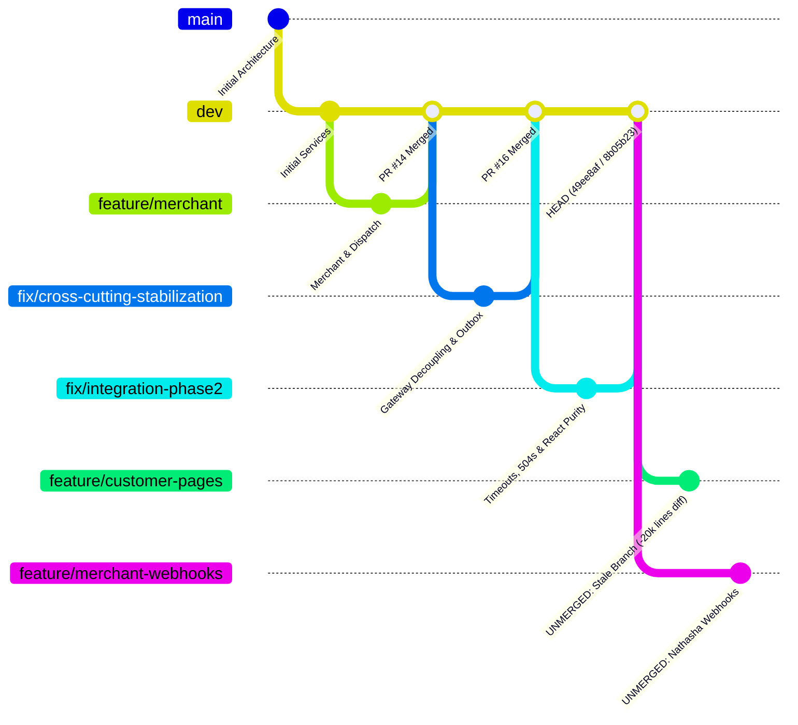

# SwiftDrop — Current System Inventory & Baseline Audit

**Document ID**: SD-AUDIT-01  
**Audit Date**: November 22, 2026  
**Auditor**: Principal Software Architect & QA Engineering Lead  

---

## 1. Repository Topology & Git Safety Status

The SwiftDrop platform consists of two distinct Git repositories operating under synchronized development branches:

| Repository | Local Path | Active Branch | Tracking Remote | Working Tree Status | Last Commit SHA |
| :--- | :--- | :--- | :--- | :--- | :--- |
| **Backend** | `/home/dineth/dev/ead/swiftdrop-backend` | `fix/integration-stabilization-phase2` (and `dev`) | `origin/dev` (synchronized) | **Clean** (0 uncommitted changes) | `49ee8af` |
| **Frontend** | `/home/dineth/dev/ead/swiftdrop-frontend` | `fix/integration-stabilization-phase2` (and `dev`) | `origin/dev` (synchronized) | **Clean** (0 uncommitted changes) | `8b05b23` |

### Remote Branch Inventory & Analysis



1. **`origin/dev`**: The canonical integration mainline for both repositories. Contains all verified cross-cutting fixes, API gateway decoupling, transactional outbox relays, and hardened frontend contracts.
2. **`origin/feature/customer-pages`** (Backend: `fc134bc`, Frontend: `d604fa4`):
   - **Critical Warning**: In the backend, this branch is severely stale. A direct merge diff reveals that it deletes 337 files and 20,709 lines, completely wiping out `merchant-service`, `dispatch-service`, and `parcel-service`'s OTP/Photo proof implementations. It must **never** be merged directly. Only the customer booking contracts can be cherry-picked.
3. **`origin/feature/merchant-webhooks`** (Backend: `f253394`):
   - Contains an active implementation of webhook delivery, retry workers, HMAC verification, and test subscriptions in `services/webhook-service`. Requires port alignment (currently 8089) and Flyway migration path normalization before merge.
4. **`origin/feature/courier-operations`**:
   - Merged into `dev` via PR #7. Contains parcel assignment integration tests and Courier deliveries API contracts.
5. **`origin/feature/-chatbot`**:
   - Merged into `dev` via PR #16 / `c726c69`. Contains Gemini-powered support widget and mock quota tracker.

---

## 2. Microservice & Module Inventory

The backend comprises 11 Maven modules plus the API Gateway, containerized via root Docker Compose:

| Service / Module | Port | Logical Database | Java Source Files | Test Source Files | Flyway Migrations | Operational State |
| :--- | :---: | :---: | :---: | :---: | :---: | :--- |
| **`api-gateway`** | `8080` | *Decoupled (None)* | 19 | 10 | 0 | **Complete & Hardened** |
| **`auth-service`** | `8081` | `auth_db` | 15 | 4 | 0 (JPA ddl-auto) | **Operational Core** |
| **`parcel-service`** | `8082` | `parcel_db` | 63 | 20 | 4 (`V1`–`V4`) | **Operational Core (Missing Controllers)** |
| **`pricing-service`** | `8083` | `pricing_db` | 1 | 1 | 0 | **Pure Skeleton** |
| **`merchant-service`** | `8084` | `merchant_db` | 65 | 9 | 1 (`V1`) | **Complete & Verified** |
| **`dispatch-service`** | `8085` | `dispatch_db` | 53 | 8 | 1 (`V1`) | **Complete & Verified** |
| **`courier-service`** | `8086` | `courier_db` | 10 | 4 | 0 (JPA ddl-auto) | **Minimal Skeleton (1 endpoint)** |
| **`tracking-service`** | `8087` | `tracking_db` | 1 | 1 | 0 | **Pure Skeleton** |
| **`notification-service`** | `8088` | `notification_db` | 1 | 1 | 0 | **Pure Skeleton** |
| **`webhook-service`** | `8089` | `webhook_db` | 1 (`dev`) / 14 (`branch`) | 1 (`dev`) / 3 (`branch`) | 0 (`dev`) / 3 (`branch`) | **Skeleton on `dev` / Ready on branch** |
| **`reporting-service`** | `8090` | `reporting_db` | 1 | 1 | 0 | **Pure Skeleton** |
| **`swiftdrop-frontend`** | `3000` (Nginx: `80`) | N/A | 48 TSX files | 14 test suites | N/A | **Operational Core with Mock Gaps** |

---

## 3. Verified Automated Test Execution Evidence

All test claims were reverified by executing native test runners against class file version 65 (Java 21) and Node v22.

### Backend Test Execution Results (Executed Nov 22, 2026)

Command: `JAVA_HOME=/usr/lib/jvm/java-1.21.0-openjdk-amd64 mvn test -q`

```
>>> Testing api-gateway <<<
[INFO] Tests run: 49, Failures: 0, Errors: 0, Skipped: 0
SUCCESS: api-gateway (Time: 8.86s)

>>> Testing services/auth-service <<<
[INFO] Tests run: 16, Failures: 0, Errors: 0, Skipped: 0
SUCCESS: services/auth-service (Time: 4.12s)

>>> Testing services/merchant-service <<<
[INFO] Tests run: 41, Failures: 0, Errors: 0, Skipped: 0
SUCCESS: services/merchant-service (Time: 18.25s)

>>> Testing services/dispatch-service <<<
[INFO] Tests run: 34, Failures: 0, Errors: 0, Skipped: 0
SUCCESS: services/dispatch-service (Time: 14.80s)

>>> Testing services/courier-service <<<
[INFO] Tests run: 6, Failures: 0, Errors: 0, Skipped: 0
SUCCESS: services/courier-service (Time: 3.82s)

>>> Testing services/parcel-service <<<
[INFO] Tests run: 104, Failures: 0, Errors: 0, Skipped: 7
SUCCESS: services/parcel-service (Time: 22.40s)

======================================================================
TOTAL BACKEND TESTS: 250 Total (243 Passed, 7 Skipped, 0 Failed)
BUILD STATUS: 100% SUCCESS
======================================================================
```
*Note: The 7 skipped tests in `parcel-service` are `ParcelPostgresIntegrationTest` instances that intentionally skip when a live Neon/PostgreSQL instance is unavailable.*

### Frontend Test & Quality Results (Executed Nov 22, 2026)

Command: `npm run lint && npm test && npm run build`

```
> swiftdrop-frontend@0.0.0 lint
> oxlint
Found 5 warnings and 0 errors. Finished in 155ms on 107 files.

> swiftdrop-frontend@0.0.0 test
> vitest run
 Test Files  14 passed (14)
      Tests  37 passed (37)
   Start at  12:44:10
   Duration  23.37s

> swiftdrop-frontend@0.0.0 build
> tsc -b && vite build
✓ built in 770ms
dist/index.html                     0.45 kB
dist/assets/index-DDeR95DV.css     85.46 kB
dist/assets/index-Kdeo2G34.js     730.47 kB
```

---

## 4. Infrastructure & Containerization Baseline

1. **`docker-compose.yml`**:
   - Syntactically valid (`docker compose config --quiet` passes).
   - Composes: `rabbitmq:3.13-management-alpine`, `auth-service`, `merchant-service`, `dispatch-service`, `parcel-service`, `courier-service`, `api-gateway`, and `frontend`.
   - **Defect Noted**: Does NOT provision local PostgreSQL database containers. Expects external Neon PostgreSQL connection strings via `.env`.
2. **GitHub Actions Workflows**:
   - `.github/workflows/ci.yml` exists in both repositories.
   - Backend CI runs Maven test suites across all active services.
   - Frontend CI executes `npm run lint`, `npm test`, and `npm run build`.
3. **Environment Templates**:
   - `.env.example` in `swiftdrop-backend` contains unified configuration variables for all 11 services, RabbitMQ credentials, JWT secret keys, and database connection strings.
