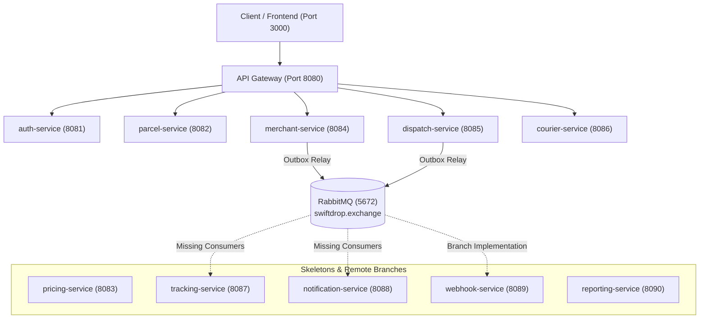

# SwiftDrop — Backend Service Audit (All 11 Modules)

**Document ID**: SD-AUDIT-02  
**Audit Date**: November 22, 2026  
**Auditor**: Principal Software Architect & Microservices Specialist  

---

## 1. Architectural Overview & Service Communication Matrix

SwiftDrop adopts a distributed microservices pattern. Downstream services do not share physical or logical databases. Synchronous requests are routed via `api-gateway` (port 8080), while asynchronous domain events are exchanged through RabbitMQ (`swiftdrop.exchange`).

---

## 2. Module-by-Module Technical Inspection

### 2.1 `api-gateway` (Port 8080)
* **Maven & Architecture**: Fully decoupled from JPA/PostgreSQL/H2. Pure stateless HTTP reverse proxy based on Spring Boot 3 Web and `RestClient`.
* **Controllers**:
  - `GatewayProxyController`: Proxies `/api/v1/merchants/**`, `/api/v1/dispatch/**`, `/api/v1/auth/**`, `/api/v1/parcels/**`, `/api/v1/couriers/**`.
  - `ChatbotController`: Integrates Gemini AI API with in-memory quota tracking (10 free messages).
* **Reliability & Resilience**:
  - Configured `SimpleClientHttpRequestFactory` with **5,000ms connect timeout** and **10,000ms read timeout**.
  - Catching `ResourceAccessException` / `SocketTimeoutException` mapping downstream timeouts to **HTTP 504 Gateway Timeout** with structured error payload:
    `{"success":false,"error":{"code":"GATEWAY_TIMEOUT","message":"Downstream service timed out"}}`.
  - Downstream connection drop mapped to **HTTP 503 Service Unavailable** (`DOWNSTREAM_SERVICE_UNAVAILABLE`).
* **Security**:
  - `JwtTokenValidator`: HMAC-SHA256 signature verification, claims extraction (`sub`, `roles`, `email`), expiration checking.
  - `JwtAuthenticationFilter`: Strips client-supplied spoofed headers (`X-User-Id`, `X-User-Roles`, `X-User-Email`) and replaces them with verified claims.
* **Test Verification**: **49/49 tests PASSED**.
* **Gaps & Missing Work**:
  - Lacks routes for `pricing-service` (`/api/v1/pricing/**`), `tracking-service` (`/api/v1/tracking/**`), and `webhook-service` (`/api/v1/merchant/webhooks/**`).
  - Lacks Spring Cloud CircuitBreaker / Resilience4j for automatic fallback shedding.

---

### 2.2 `auth-service` (Port 8081)
* **Architecture**: Spring Security 6 stateless filter chain, BCrypt password encoder, JJWT token issuance.
* **Database**: `auth_db` (currently using `ddl-auto: update`, no Flyway migrations).
* **Controllers & Endpoints**:
  - `POST /api/v1/auth/login`: Authenticates credentials and returns JWT bearer token.
  - `POST /api/v1/auth/register`: Creates new user records.
  - `GET /api/v1/auth/me`: Validates token and returns current user claims.
* **Demo Seed Accounts**: Automatically seeds `admin@demo.com`, `merchant@demo.com`, `courier@demo.com`, `dispatcher@demo.com`, `customer@demo.com`.
* **Test Verification**: **16/16 tests PASSED**.
* **Defects & Gaps**:
  - **No Flyway Migrations**: Relies on Hibernate DDL auto-generation in production, risking schema drift.
  - **Missing Refresh Token Mechanism**: Tokens are single-lifespan; no token rotation or revocation blacklist exists.
  - **Missing Role Hierarchy**: Roles are simple strings (`ROLE_ADMIN`, `ROLE_MERCHANT`); fine-grained resource permissions are missing.

---

### 2.3 `parcel-service` (Port 8082)
* **Architecture**: High-integrity aggregate domain with Flyway migrations V1–V4 (`parcel_db`).
* **Existing Domain Capabilities**:
  - `Parcel`: Core entity with status lifecycle (`CREATED`, `ASSIGNED`, `PICKED_UP`, `IN_TRANSIT`, `DELIVERED`, `FAILED`).
  - `ParcelAssignment`: Historical courier assignment records with check constraints.
  - `ParcelStatusHistory`: Transactional audit log of all status transitions with actor attribution.
  - `ParcelDeliveryOtpChallenge`: Cryptographic HMAC-SHA256 6-digit OTP challenge generator with 60s cooldown and 3-attempt limit.
  - `ParcelDeliveryPhotoProof`: Multipart file upload, SHA-256 digest calculation, Cloudinary cloud storage provider with conflict avoidance.
  - `DeliveryCompletionService`: Atomic two-phase verification requiring valid OTP challenge AND verified photo proof before marking parcel `DELIVERED`.
* **Critical Defect / Integration Gap**:
  - **MISSING REST CONTROLLERS**: Although the OTP, Photo Proof, and Delivery Completion domain services are fully implemented with unit and concurrency tests, **no HTTP endpoints exist to expose them**.
  - `ParcelController.java` only exposes `/internal/v1/parcels/{parcelId}/assignments`, `/internal/v1/parcels` (by courier ID), and `/internal/v1/parcels/{id}/assignment-history`.
  - The frontend expects `/api/v1/parcels/{id}/delivery-otp`, `/api/v1/parcels/{id}/delivery-otp/verify`, `/api/v1/parcels/{id}/delivery-photo`, `/api/v1/parcels/{id}/complete`, and `/api/v1/parcels/{id}/status`. Calls to these endpoints currently result in **HTTP 404 Not Found**.
* **Test Verification**: **97/97 tests PASSED** (7 integration tests skipped due to missing live PostgreSQL credentials).

---

### 2.4 `merchant-service` (Port 8084)
* **Architecture**: Complete aggregate root for merchant onboarding and administrative verification. Flyway schema `V1__init_merchant_schema.sql` creates 8 tables in `merchant_db`.
* **Controllers & Endpoints**:
  - `MerchantOnboardingController`: `/api/v1/merchants/onboarding/**` (Registration, profile update, multi-hub pickup addresses, bank accounts, KYC document uploads, submission).
  - `MerchantAdminController`: `/api/v1/merchants/admin/**` (Application queues, document approval/rejection, pricing tier assignment `STANDARD`/`SILVER`/`GOLD`/`ENTERPRISE`, formal rejection).
  - `MerchantCredentialController`: `/api/v1/merchants/credentials/**` (Secure API key generation `sk_live_...` / `sk_test_...` storing SHA-256 hash and 16-character prefix, key revocation, webhook registration).
* **Event-Driven Outbox**:
  - Writes events (`MERCHANT_SUBMITTED`, `MERCHANT_APPROVED`, `MERCHANT_REJECTED`) to `outbox_events`.
  - `OutboxPublisherWorker` polls `PENDING` records, publishes to RabbitMQ `swiftdrop.exchange` with routing key `merchant.{eventType}`, and marks them `PUBLISHED` with exponential backoff up to 5 retries.
* **Test Verification**: **41/41 tests PASSED**.
* **Gaps**: Lacks multi-currency support (hardcoded to `LKR`), and physical document files are stored in database BLOBs rather than external object storage (S3/GCS/Cloudinary).

---

### 2.5 `dispatch-service` (Port 8085)
* **Architecture**: Comprehensive logistics state machine with Flyway `V1__init_dispatch_schema.sql` (`dispatch_db`).
* **Core Algorithms & Engines**:
  - `ProximityMatchingService`: Computes Great-Circle Haversine distances:
    $$d = 2R \arcsin\left(\sqrt{\sin^2(\Delta\phi/2) + \cos\phi_1\cos\phi_2\sin^2(\Delta\lambda/2)}\right)$$
    Scores candidates factoring distance (60%) and active courier delivery load (200%).
  - `DispatchJobService`: Manages assignment offers with 60s expiration TTL countdown.
  - `AutoDispatchEngine`: Scheduled worker automatically sweeping expired offers and running proximity batch matching on unassigned jobs.
  - `CourierStatusProjectionController`: Maintains a high-speed local projection cache (`courier_status_cache`) avoiding distributed joins to `courier_db`.
* **Outbox Infrastructure**:
  - Writes `DISPATCH_OFFERED`, `DISPATCH_ACCEPTED`, `DISPATCH_EXPIRED` to `outbox_events`.
  - `OutboxPublisherWorker` relays events to RabbitMQ `swiftdrop.exchange` under `dispatch.{eventType}`.
* **Test Verification**: **34/34 tests PASSED**.
* **Gaps**: Proximity engine uses circular Euclidean/Haversine distance rather than actual road routing network / Google Maps Distance Matrix.

---

### 2.6 `courier-service` (Port 8086)
* **Architecture**: Spring Boot application backed by `courier_db`.
* **Current State**: **EXTREMELY MINIMAL**.
  - Only contains one entity: `Courier.java` (`id`, `name`, `vehicleType`, `vehiclePlate`, `rating`, `available`, `deliveriesToday`, `totalDeliveries`).
  - Only exposes **one single endpoint**: `GET /api/v1/couriers/{id}`.
* **Defects & Gaps**:
  - **No `/couriers/me` endpoint**: Frontend `courierApi.getCurrentProfile()` calls `/couriers/me`, which fails with 404.
  - **No Courier Registration or KYC**: No onboarding workflow for new courier applicants.
  - **No Live Telemetry / GPS**: No endpoint to update courier latitude, longitude, and active shift state.
  - **No Vehicle Documents**: No driver's license or insurance verification.
  - **No Flyway Migrations**: Relies on Hibernate DDL auto-generation.
* **Test Verification**: **6/6 tests PASSED**.

---

### 2.7 `pricing-service` (Port 8083)
* **Current State**: **PURE SKELETON**.
  - Contains only `PricingServiceApplication.java` and a smoke context-load test.
  - Zero domain entities, zero controllers, zero services, zero database configuration.
* **Missing Work**:
  - Weight tier calculations (Base fee + excess per-kg rate).
  - Zone-to-zone distance matrices (inter-district vs intra-city).
  - Volumetric weight divisor ($L \times W \times H / 5000$).
  - Pricing endpoints: `POST /api/v1/pricing/calculate`.

---

### 2.8 `tracking-service` (Port 8087)
* **Current State**: **PURE SKELETON**.
  - Contains only `TrackingServiceApplication.java` and one test.
* **Missing Work**:
  - Read-optimized tracking projection schema (`tracking_events` with indexed `tracking_number`).
  - RabbitMQ event listener consuming `parcel.*` and `dispatch.*` events from `swiftdrop.exchange`.
  - Public track & trace REST endpoint: `GET /api/v1/tracking/{trackingNumber}`.
  - Real-time Server-Sent Events (SSE) or WebSocket channel for live courier location updates.

---

### 2.9 `notification-service` (Port 8088)
* **Current State**: **PURE SKELETON**.
  - Contains only `NotificationServiceApplication.java` and one test.
* **Missing Work**:
  - Multi-channel notification dispatchers (Email via SendGrid/SMTP, SMS via Twilio/local gateway).
  - Notification audit table (`notifications` tracking `recipient`, `channel`, `template`, `delivery_status`).
  - RabbitMQ listener subscribing to `parcel.created`, `parcel.otp_generated`, `parcel.delivered`, `dispatch.offered`.

---

### 2.10 `webhook-service` (Port 8089)
* **Current State on `dev`**: **PURE SKELETON**.
* **Current State on Remote Branch `origin/feature/merchant-webhooks`**:
  - Author: Nathasha Oshani.
  - Fully implemented subscription manager (`LocalWebhookController`, `LocalWebhookAccess`).
  - Delivery retry worker (`DeliveryWorker`, `DeliveryWorkflow`) with exponential backoff.
  - SHA-256 HMAC signature calculation (`X-SwiftDrop-Signature`).
  - 3 database migrations in `db/local-migration/`.
* **Necessary Adjustments Before Merge**:
  - Standardize Flyway migration path to `src/main/resources/db/migration/`.
  - Remove local test profile requirement.
  - Map proxy route in API Gateway (`/api/v1/merchant/webhooks/**`).

---

### 2.11 `reporting-service` (Port 8090)
* **Current State**: **PURE SKELETON**.
  - Contains only `ReportingServiceApplication.java` and one test.
* **Missing Work**:
  - Analytics aggregate projections (Delivery success rate, on-time delivery %, courier utilization, merchant volume).
  - Scheduled daily aggregation jobs.
  - Reporting endpoints for dispatcher dashboard (`GET /api/v1/reports/dispatch-summary`).
