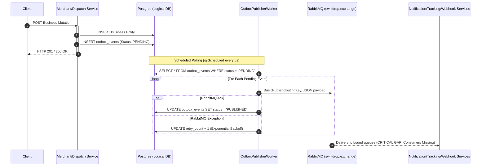

# SwiftDrop — API & Event Integration Audit

**Document ID**: SD-AUDIT-05  
**Audit Date**: November 22, 2026  
**Auditor**: Microservices Integration & Event Systems Architect  

---

## 1. Synchronous REST Integration & Gateway Routing

The SwiftDrop API Gateway (`api-gateway`, port 8080) acts as the single edge ingress. It terminates client connections, validates JWT tokens, strips spoofed client headers, and proxies requests to downstream microservices using Spring's `RestClient`.

### Gateway Proxy Route Mapping Table

| Public Path Pattern | Downstream Service | Target Service Port | Auth Required? | Role Restrictions | Status |
| :--- | :--- | :---: | :---: | :---: | :--- |
| `/api/v1/auth/**` | `auth-service` | `8081` | No | None (Public) | **OPERATIONAL** |
| `/api/v1/merchants/**` | `merchant-service` | `8084` | Yes | `ROLE_MERCHANT`, `ROLE_ADMIN` | **OPERATIONAL** |
| `/api/v1/dispatch/**` | `dispatch-service` | `8085` | Yes | `ROLE_DISPATCHER`, `ROLE_COURIER`, `ROLE_ADMIN` | **OPERATIONAL** |
| `/api/v1/parcels/**` | `parcel-service` | `8082` | Yes | `ROLE_COURIER`, `ROLE_CUSTOMER`, `ROLE_ADMIN` | **BLOCKED (Controller Gaps)** |
| `/api/v1/couriers/**` | `courier-service` | `8086` | Yes | `ROLE_COURIER`, `ROLE_DISPATCHER`, `ROLE_ADMIN` | **PARTIAL (1 endpoint only)** |
| `/api/v1/chatbot/**` | Direct (Gateway Local) | `8080` | Optional | Quota-governed (10 free) | **OPERATIONAL** |
| `/api/v1/pricing/**` | `pricing-service` | `8083` | Planned | `ROLE_CUSTOMER`, `ROLE_MERCHANT` | **MISSING ROUTE & SERVICE** |
| `/api/v1/tracking/**` | `tracking-service` | `8087` | Planned | Public | **MISSING ROUTE & SERVICE** |
| `/api/v1/notifications/**`| `notification-service`| `8088` | Planned | Internal / User-specific | **MISSING ROUTE & SERVICE** |
| `/api/v1/merchant/webhooks/**`| `webhook-service` | `8089` | Planned | `ROLE_MERCHANT`, `ROLE_ADMIN` | **MISSING ROUTE (On branch)** |
| `/api/v1/reports/**` | `reporting-service` | `8090` | Planned | `ROLE_ADMIN`, `ROLE_DISPATCHER` | **MISSING ROUTE & SERVICE** |

### Network Timeout & Error Contract
* **Connect Timeout**: 5,000 ms.
* **Read Timeout**: 10,000 ms.
* **Downstream Timeout Mapping**: `SocketTimeoutException` caught $\rightarrow$ **HTTP 504 Gateway Timeout**:
  ```json
  {
    "success": false,
    "error": {
      "code": "GATEWAY_TIMEOUT",
      "message": "Downstream service timed out"
    }
  }
  ```
* **Downstream Offline Mapping**: Connection refused caught $\rightarrow$ **HTTP 503 Service Unavailable**:
  ```json
  {
    "success": false,
    "error": {
      "code": "DOWNSTREAM_SERVICE_UNAVAILABLE",
      "message": "Downstream service unavailable"
    }
  }
  ```

---

## 2. Event-Driven Architecture (RabbitMQ & Transactional Outbox)

The event backbone uses a centralized Topic Exchange:
* **Exchange Name**: `swiftdrop.exchange`
* **Exchange Type**: `topic`
* **Message Converter**: `Jackson2JsonMessageConverter`



### Event Producers & Outbox Matrix

| Service | Outbox Table | Outbox Worker | Target Routing Key | Active In Production? |
| :--- | :---: | :---: | :--- | :---: |
| **`merchant-service`** | `outbox_events` | `OutboxPublisherWorker.java` | `merchant.MERCHANT_SUBMITTED`<br>`merchant.MERCHANT_APPROVED`<br>`merchant.MERCHANT_REJECTED` | **YES** |
| **`dispatch-service`** | `outbox_events` | `OutboxPublisherWorker.java` | `dispatch.DISPATCH_OFFERED`<br>`dispatch.DISPATCH_ACCEPTED`<br>`dispatch.DISPATCH_EXPIRED` | **YES** |
| **`parcel-service`** | **NONE** | **NONE** | *None emitted* | **CRITICAL GAP** |
| **`auth-service`** | **NONE** | **NONE** | *None emitted* | **NONE** |

---

## 3. The Broken Consumer Loop (Critical Architectural Gap)

While `merchant-service` and `dispatch-service` reliably publish transactional domain events into `swiftdrop.exchange`, **no service is currently consuming these events**:

1. **`notification-service` (Skeleton)**:
   - Does not have `@RabbitListener` queues.
   - When a parcel is delivered or a merchant is approved, no email or SMS notification is triggered.
2. **`tracking-service` (Skeleton)**:
   - Does not consume `dispatch.DISPATCH_ACCEPTED` or `parcel.PARCEL_STATUS_CHANGED`.
   - Cannot build a live read projection for public tracking.
3. **`webhook-service` (Skeleton on `dev`)**:
   - Nathasha's branch (`origin/feature/merchant-webhooks`) implements delivery logic, but is not yet wired to listen to `swiftdrop.exchange` events from `merchant-service` or `parcel-service`.
4. **`parcel-service` (No Outbox)**:
   - Generates status updates (`PICKED_UP`, `DELIVERED`, `FAILED`), but has **no outbox table or publisher**.
   - These status updates remain locked in `parcel_db` and never reach the message bus.

---

## 4. Standard Event Payload Specification (Mandated Standard)

To eliminate ad-hoc JSON payloads, all microservices must adhere to the versioned SwiftDrop Event Envelope:

```json
{
  "eventId": "a7b3c9d1-0000-4000-8000-000000000001",
  "eventType": "PARCEL_STATUS_UPDATED",
  "version": 1,
  "aggregateType": "PARCEL",
  "aggregateId": "PRC-2026-9901",
  "occurredAt": "2026-11-22T13:00:00Z",
  "correlationId": "req-98716234-abcd",
  "actor": {
    "userId": "usr-courier-44",
    "role": "ROLE_COURIER"
  },
  "payload": {
    "previousStatus": "IN_TRANSIT",
    "newStatus": "DELIVERED",
    "location": {
      "latitude": 6.9271,
      "longitude": 79.8612
    },
    "proof": {
      "otpVerified": true,
      "photoProofId": "cf-asset-98213"
    }
  }
}
```
