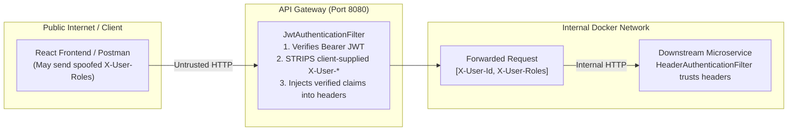

# SwiftDrop — Security & Reliability Audit

**Document ID**: SD-AUDIT-06  
**Audit Date**: November 22, 2026  
**Auditor**: Principal Cybersecurity & Distributed Systems Reliability Specialist  

---

## 1. Authentication & Cryptographic Integrity

### 1.1 JWT Token Architecture
* **Algorithm**: HMAC-SHA256 (`HmacSHA256`).
* **Secret Key Requirement**: Enforces minimum 32 UTF-8 bytes (256 bits) of cryptographic entropy via `JwtTokenValidator`.
* **Payload Claims**:
  - `sub`: User UUID identifier.
  - `roles`: Collection of assigned authorities (e.g., `["ROLE_MERCHANT"]`).
  - `email`: Authenticated user email.
  - `iat` / `exp`: Issue and expiration epoch timestamps (standard 24-hour validity).

### 1.2 Cryptographic Vulnerabilities & Gaps
1. **P1: Missing Token Revocation / Blacklist**:
   - JWT tokens are stateless. Once issued, a token remains valid until its 24-hour expiration.
   - If a courier's device is stolen or a merchant's credentials are compromised, an administrator cannot revoke the token without rotating the global `JWT_SECRET` (which invalidates all users across the platform).
2. **P2: Missing Refresh Token Rotation**:
   - Clients must re-enter credentials every 24 hours. No secure `HttpOnly` refresh token mechanism exists.

---

## 2. Identity Propagation & Perimeter Trust Boundaries

### 2.1 Perimeter Header Stripping (Verified Secure)
* In `GatewayProxyController.java`, incoming client headers are processed.
* Test case `GatewayProxyControllerTest.shouldStripClientInjectedIdentityHeaders()` verifies that if an attacker sends:
  `X-User-Roles: ROLE_ADMIN`
  the Gateway strips it before forwarding to downstream microservices.

### 2.2 Internal Network Trust Risk (P1 Security Finding)
* Downstream services (`merchant-service`, `dispatch-service`, `courier-service`) use a `HeaderAuthenticationFilter` that trusts any HTTP request containing `X-User-Roles` and `X-User-Id`.
* **Attack Scenario**: If an attacker gains access to the internal Docker container network or if services are deployed in a shared VPC without port restrictions, they can bypass the API Gateway entirely and call `http://merchant-service:8084/api/v1/merchants/admin/...` with forged admin headers.
* **Remediation**:
  - In Docker Compose / Kubernetes, do not expose backend service ports (8081–8090) to the host or public internet; expose only the Gateway (port 8080).
  - Implement mutual TLS (mTLS) or an internal shared HMAC signature header (`X-Internal-Gateway-Signature`) validated by downstream filters.

---

## 3. Resource-Level Authorization Flaws

| Service | Route Pattern | Role Check in Gateway | Resource Authorization in Service | Status |
| :--- | :--- | :--- | :--- | :--- |
| **`merchant-service`** | `/api/v1/merchants/admin/**` | `ROLE_ADMIN` | Enforces admin actor verification | **SECURE** |
| **`merchant-service`** | `/api/v1/merchants/onboarding/**` | `ROLE_MERCHANT` | Verifies `merchant.userId == callerId` | **SECURE** |
| **`dispatch-service`** | `/api/v1/dispatch/jobs/**` | `ROLE_DISPATCHER`, `ROLE_ADMIN` | Verifies dispatcher role | **SECURE** |
| **`dispatch-service`** | `/api/v1/dispatch/courier/**` | `ROLE_COURIER` | Verifies `actorId == assignment.courierId` | **SECURE** |
| **`courier-service`** | `/api/v1/couriers/**` | `permitAll()` in Gateway | **NONE**: Allows unauthenticated reading of any courier profile | **VULNERABLE** |
| **`parcel-service`** | `/internal/v1/parcels/**` | `ROLE_ADMIN`, `ROLE_COURIER` | No ownership check on parcel assignment queries | **VULNERABLE** |

---

## 4. Secrets Management & Hardcoded Configurations

1. **P0: Hardcoded Fallback Secrets in Properties**:
   - `dispatch-service` and `merchant-service` contain hardcoded Neon PostgreSQL connection strings with hostnames in their `application.properties` default fallbacks:
     `spring.datasource.url=${MERCHANT_DB_URL:jdbc:postgresql://ep-long-tooth-aod34x2e-pooler...}`
   - If an environment variable is omitted in deployment, services fall back to these endpoints.
   - **Fix**: Remove hardcoded connection strings from `application.properties`. Fail startup immediately if `${MERCHANT_DB_URL}` or `${JWT_SECRET}` is missing.
2. **Positive Security Implementation in `merchant-service`**:
   - API Keys (`sk_live_...`, `sk_test_...`) are **never stored in plaintext**.
   - The raw secret is hashed using `MessageDigest.getInstance("SHA-256")`.
   - The database stores only `key_hash` and `key_prefix` (e.g. `sk_live_9a8b...`).
   - Plaintext secret is returned to the client exactly once upon generation.

---

## 5. Distributed Systems Reliability & Resilience

1. **Timeout Resilience**:
   - **Connect**: 5 seconds.
   - **Read**: 10 seconds.
   - Mapped to standard HTTP 504.
2. **Missing Rate Limiting**:
   - No rate limiting or request throttling is configured on `/api/v1/auth/login` (brute force vulnerability) or `/api/v1/chatbot/message` (denial of wallet/resource vulnerability).
   - **Fix**: Implement Redis-backed token bucket rate limiting (Bucket4j or Spring Cloud Gateway RateLimiter).
3. **Missing Distributed Tracing**:
   - No `X-Correlation-Id` or `traceparent` is injected at the Gateway and propagated across HTTP and RabbitMQ calls.
   - Diagnosing multi-service request failures requires manual cross-service log correlation.
