# SwiftDrop — End-to-End Business Workflow Gap Analysis

**Document ID**: SD-AUDIT-07  
**Audit Date**: November 22, 2026  
**Auditor**: Principal Enterprise Solutions Architect  

---

## 1. Executive Summary: The Disconnected Chains

While individual microservices and frontend screens exist and pass localized unit tests, the end-to-end integration across the platform suffers from **critical broken links**:

```mermaid
flowchart TD
    subgraph CustomerChain ["1. Customer Booking Workflow"]
        C1["Registration & Login (OK)"] --> C2["Book Parcel (CRITICAL: localStorage)"]
        C2 -.->|BROKEN: No API Call| C3["Pricing Service (SKELETON)"]
        C2 -.->|BROKEN: No API Call| C4["Parcel DB (Postgres)"]
        C4 -.->|BROKEN: No Event| C5["Dispatch Queue"]
    end

    subgraph MerchantChain ["2. Merchant Onboarding & Order Workflow"]
        M1["Onboarding & KYC (OK)"] --> M2["Admin Approval & Tier (OK)"]
        M2 --> M3["API Key Issuance (OK)"]
        M3 --> M4["Merchant Order Placement"]
        M4 -.->|BROKEN: Preview Lock / Mocks| M5["Parcel & Dispatch Creation"]
        M5 -.->|BROKEN: Skeleton Service| M6["Webhook Event Delivery"]
    end

    subgraph CourierChain ["3. Courier Fulfillment Workflow"]
        CR1["Courier Login (OK)"] --> CR2["View Deliveries"]
        CR2 -.->|BROKEN: 404 Missing Controller| CR3["Fetch Active Assignments"]
        CR3 -.->|BROKEN: 404 Missing Controller| CR4["OTP Verification & POD Upload"]
        CR4 -.->|BROKEN: 404 Missing Controller| CR5["Delivery Completion"]
    end
```

---

## 2. Step-by-Step Workflow Analysis

### 2.1 Workflow 1: Customer Booking to Delivery
| Step | Action | Expected Integration | Actual Reality | Health Status |
| :---: | :--- | :--- | :--- | :---: |
| 1 | Register / Login | `auth-service` JWT issuance | Works 100% via API Gateway | **PASS** |
| 2 | Address & Parcel Form | Input sender/recipient coordinates | UI is rich, supports Sri Lankan districts | **PASS** |
| 3 | Fee Calculation | Call `pricing-service` for rates | Hardcoded client-side JS formula in `BookParcel.tsx` | **FAIL (Fake)** |
| 4 | Booking Submission | `POST /api/v1/parcels` | Saves to browser `localStorage` (`KEY = swiftdrop_parcels_v1`) | **CRITICAL FAIL** |
| 5 | Waybill Generation | Server generates cryptographic waybill | Client renders mock label from local state | **FAIL (Fake)** |
| 6 | Dispatch Entry | Parcel appears in unassigned queue | Parcel never leaves customer's browser; invisible to dispatch | **CRITICAL FAIL** |
| 7 | Public Tracking | Public query by tracking number | `PublicTracking.tsx` searches `localStorage` | **FAIL (Fake)** |
| 8 | Delivery Notification | SMS/Email to recipient | `notification-service` is skeleton; 0 notifications sent | **FAIL (Missing)** |

---

### 2.2 Workflow 2: Merchant Lifecycle & Order Creation
| Step | Action | Expected Integration | Actual Reality | Health Status |
| :---: | :--- | :--- | :--- | :---: |
| 1 | Merchant Registration | `POST /api/v1/merchants/onboarding/register` | Stores business, contacts, hubs in `merchant_db` | **PASS** |
| 2 | Bank Account & Hubs | `POST /api/v1/merchants/onboarding/addresses` | Validates GPS coordinates and bank settlement cycle | **PASS** |
| 3 | KYC Documents Upload | `POST /api/v1/merchants/onboarding/documents` | Uploads BR, TIN, Director IDs | **PASS** |
| 4 | Admin Compliance Review| `GET /api/v1/merchants/admin/merchants` | Admin inspects dossier and approves with pricing tier | **PASS** |
| 5 | API Credentials | `POST /api/v1/merchants/credentials/keys` | Generates `sk_live_...`, stores SHA-256 hash | **PASS** |
| 6 | Order Submission | `POST /api/v1/merchants/orders` | Blocked by `MerchantModuleBoundary` preview lock | **FAIL (Blocked)** |
| 7 | Bulk CSV Ingestion | `POST /api/v1/merchants/orders/bulk` | `BulkBooking.tsx` renders static `MOCK_PARCELS` | **FAIL (Fake)** |
| 8 | Webhook Event Relay | Webhook dispatched on parcel status | Implemented on branch `feature/merchant-webhooks`, unmerged | **PARTIAL** |

---

### 2.3 Workflow 3: Courier Assignment, Fulfillment, & Proof of Delivery (POD)
| Step | Action | Expected Integration | Actual Reality | Health Status |
| :---: | :--- | :--- | :--- | :---: |
| 1 | Courier Shift Start | `POST /api/v1/couriers/shift` | `courier-service` has no shift or availability endpoints | **FAIL (Missing)** |
| 2 | Live Proximity Ingestion | GPS telemetry to `dispatch-service` | `CourierStatusProjectionController` accepts updates | **PASS** |
| 3 | Job Assignment Offer | 60s TTL countdown offer | `dispatch-service` auto-dispatch engine creates assignment | **PASS** |
| 4 | Courier Decision | `POST /dispatch/courier/jobs/{id}/decision` | Courier accepts/declines job via `CourierResponseController` | **PASS** |
| 5 | Deliveries Queue View | `GET /api/v1/parcels/me/assigned-deliveries` | `parcel-service` has no controller for this route $\rightarrow$ **HTTP 404** | **CRITICAL FAIL** |
| 6 | Status Updates | `PATCH /api/v1/parcels/{id}/status` | `parcel-service` has no controller for this route $\rightarrow$ **HTTP 404** | **CRITICAL FAIL** |
| 7 | OTP Verification | `POST /api/v1/parcels/{id}/delivery-otp/verify` | Service exists, but **NO CONTROLLER** $\rightarrow$ **HTTP 404** | **CRITICAL FAIL** |
| 8 | Photo Proof Upload | `POST /api/v1/parcels/{id}/delivery-photo` | Service exists, but **NO CONTROLLER** $\rightarrow$ **HTTP 404** | **CRITICAL FAIL** |
| 9 | Completion Finalization| `POST /api/v1/parcels/{id}/complete` | Service exists, but **NO CONTROLLER** $\rightarrow$ **HTTP 404** | **CRITICAL FAIL** |

---

### 2.4 Workflow 4: Dispatcher Control Center
| Step | Action | Expected Integration | Actual Reality | Health Status |
| :---: | :--- | :--- | :--- | :---: |
| 1 | View Unassigned Queue | `GET /api/v1/dispatch/jobs/unassigned` | Operational via API Gateway | **PASS** |
| 2 | Candidate Proximity View| `GET /api/v1/dispatch/jobs/{id}/candidates` | Great-Circle Haversine scoring with active delivery weighting | **PASS** |
| 3 | Manual Assignment | `POST /api/v1/dispatch/jobs/{id}/assign` | Operational via API Gateway | **PASS** |
| 4 | Batch Auto-Dispatch | `POST /api/v1/dispatch/jobs/auto-dispatch` | Sweeper assigns eligible jobs in batches | **PASS** |
| 5 | Dashboard KPI Summary | `GET /api/v1/reports/dispatch-summary` | `DispatcherDashboard.tsx` pulls from `MOCK_REPORT` | **FAIL (Fake)** |
| 6 | All Parcels Master List| `GET /api/v1/parcels` | `DispatcherParcels.tsx` pulls from `MOCK_PARCELS` | **FAIL (Fake)** |

---

### 2.5 Workflow 5: Failed Delivery & Exception Handling
| Step | Action | Expected Integration | Actual Reality | Health Status |
| :---: | :--- | :--- | :--- | :---: |
| 1 | Courier Marks Failed | `PATCH /api/v1/parcels/{id}/status` | Domain validation logic exists, but controller is missing | **CRITICAL FAIL** |
| 2 | Status History Recorded | `parcel_status_history` audit log | Domain entity exists, but unreachable via API | **BLOCKED** |
| 3 | Outbox Event Published | `parcel.PARCEL_FAILED` to RabbitMQ | `parcel-service` has no transactional outbox table | **FAIL (Missing)** |
| 4 | Merchant Notification | Webhook or email to merchant | `notification-service` is skeleton; 0 alerts sent | **FAIL (Missing)** |
| 5 | Re-dispatch / Return | Dispatch job reset to `PENDING_DISPATCH` | Logic exists in dispatch-service, but needs parcel event | **BLOCKED** |

---

### 2.6 Workflow 6: Event Choreography Across Microservices
| Step | Action | Expected Integration | Actual Reality | Health Status |
| :---: | :--- | :--- | :--- | :---: |
| 1 | Business Transaction | DB entity + Outbox record in 1 TX | Implemented in Merchant and Dispatch services | **PASS** |
| 2 | Outbox Relay | Polling worker publishes to RabbitMQ | `OutboxPublisherWorker` publishing to `swiftdrop.exchange` | **PASS** |
| 3 | Message Routing | Topic routing keys (`merchant.*`, `dispatch.*`)| Messages routed to RabbitMQ topic exchange | **PASS** |
| 4 | Consumer Ingestion | Notification, Tracking, and Webhooks consume | **ZERO CONSUMERS CONFIGURED** across the platform | **CRITICAL FAIL** |
| 5 | State Synchronization | Projections updated asynchronously | Broken; system remains siloed | **CRITICAL FAIL** |
