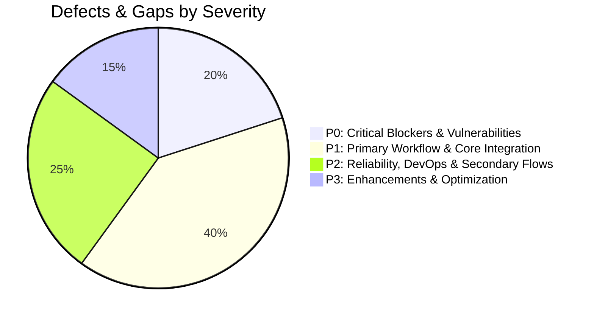

# SwiftDrop — Prioritized Gap & Defect Register

**Document ID**: SD-AUDIT-08  
**Audit Date**: November 22, 2026  
**Auditor**: Principal QA Architect & Microservices Engineering Lead  

---

## 1. Summary of Identified Defects & Gaps by Severity

---

## 2. P0: Critical Blockers, Data Integrity & Core Transaction Gaps

### GAP-DB-01: Missing Base `parcels` Table Flyway Migration
* **Module**: `services/parcel-service`
* **Existing Implementation**: `V1__create_parcel_assignments.sql` creates `parcel_assignments` with a foreign key referencing `public.parcels (id)`.
* **Actual Defect**: No Flyway migration script exists to create `public.parcels`. The table was manually created in test scripts only.
* **Why It Matters**: Running Flyway on a clean PostgreSQL database causes migration failure on step V1. Production deployment is impossible.
* **Required Correction**: Create `V0__create_parcels_table.sql` (or renumber migrations) defining `public.parcels` with tracking number, status, sender, recipient, and coordinates check constraints.
* **Dependencies**: None.
* **Priority**: **P0** | **Phase**: Phase 1.
* **Acceptance Criteria**: `mvn flyway:migrate` passes cleanly from a completely blank database.
* **Required Tests**: Clean PostgreSQL migration integration test.

---

### GAP-BE-01: Missing REST Controllers for OTP, Photo Proof, and POD Completion
* **Module**: `services/parcel-service`
* **Existing Implementation**: Domain services (`OtpChallengeService`, `DeliveryPhotoProofService`, `DeliveryCompletionService`, `ParcelStatusService`) are fully implemented and tested.
* **Actual Defect**: No Spring `@RestController` exists exposing these services via HTTP.
* **Why It Matters**: Frontend Courier POD and status update screens receive **HTTP 404 Not Found** on all delivery completion attempts.
* **Required Correction**: Create `ParcelDeliveryController.java` exposing:
  - `POST /api/v1/parcels/{id}/delivery-otp`
  - `POST /api/v1/parcels/{id}/delivery-otp/verify`
  - `POST /api/v1/parcels/{id}/delivery-photo`
  - `POST /api/v1/parcels/{id}/complete`
  - `PATCH /api/v1/parcels/{id}/status`
  - `GET /api/v1/parcels/me/assigned-deliveries`
* **Dependencies**: GAP-DB-01.
* **Priority**: **P0** | **Phase**: Phase 1.
* **Acceptance Criteria**: Courier can request OTP, verify code, upload photo proof, and mark parcel delivered via HTTP API.
* **Required Tests**: Controller mockMvc unit tests, WebMvc security tests, end-to-end completion integration tests.

---

### GAP-FE-01: Customer Booking and Tracking Operating on `localStorage`
* **Module**: `swiftdrop-frontend` (`src/features/customer/`, `src/features/tracking/`)
* **Existing Implementation**: `BookParcel.tsx`, `MyParcels.tsx`, and `PublicTracking.tsx` render complete UI forms.
* **Actual Defect**: Uses `parcel-store.ts` saving parcels into browser `localStorage` (`swiftdrop_parcels_v1`) and calculating fees using client-side JavaScript.
* **Why It Matters**: Customer bookings never reach the backend database, never enter the dispatch queue, and cannot be tracked by other users or services.
* **Required Correction**: Implement `customerParcelApi.ts` calling real backend endpoints (`POST /api/v1/parcels`, `GET /api/v1/parcels/customer/me`, `GET /api/v1/tracking/{trackingNumber}`).
* **Dependencies**: GAP-BE-01, GAP-BE-04 (`pricing-service`).
* **Priority**: **P0** | **Phase**: Phase 1.
* **Acceptance Criteria**: Booking a parcel creates a persistent row in `parcel_db`, renders real tracking number, and appears in dispatcher queue.
* **Required Tests**: React integration tests asserting Axios calls and state updating from server response.

---

### GAP-BE-02: Hardcoded Secrets and Neon Database Credentials in Properties
* **Module**: `merchant-service`, `dispatch-service`
* **Existing Implementation**: `application.properties` contains fallback connection strings pointing to live Neon AWS clusters.
* **Actual Defect**: Credentials and endpoints are committed in repository source files.
* **Why It Matters**: Security exposure risk; potential accidental connection to shared development databases during automated local testing.
* **Required Correction**: Strip hardcoded database hostnames and passwords from `application.properties`. Enforce mandatory environment variable substitution with startup validation.
* **Dependencies**: None.
* **Priority**: **P0** | **Phase**: Phase 1.
* **Acceptance Criteria**: Services fail startup with clear descriptive error messages if required database environment variables are omitted.
* **Required Tests**: Environment property validation tests.

---

## 3. P1: Primary Workflows & Core Integration Gaps

### GAP-BE-03: `courier-service` Missing Profile, Shift & Location Endpoints
* **Module**: `services/courier-service`
* **Existing Implementation**: Entity `Courier.java` with a single endpoint `GET /api/v1/couriers/{id}`.
* **Actual Defect**: Lacks `/api/v1/couriers/me`, shift management (`/shift/start`, `/shift/end`), and GPS location ingestion.
* **Why It Matters**: Frontend `courierApi.getCurrentProfile()` fails with 404; couriers cannot manage shifts or update availability.
* **Required Correction**: Implement `CourierManagementController` with `/me`, `/availability`, `/shift`, and Flyway migration `V1__init_courier_schema.sql`.
* **Dependencies**: None.
* **Priority**: **P1** | **Phase**: Phase 2.

---

### GAP-FE-02: Courier Frontend Bypassing API Gateway
* **Module**: `swiftdrop-frontend` (`src/features/courier/api/courier.api.ts`)
* **Existing Implementation**: Line 5 defaults `COURIER_API_BASE_URL` to `http://localhost:8086/api/v1`.
* **Actual Defect**: Directly attacks courier microservice port 8086, bypassing API Gateway security, JWT validation, and CORS policies.
* **Required Correction**: Normalize base URL to canonical Gateway URL: `http://localhost:8080/api/v1`.
* **Dependencies**: GAP-BE-03.
* **Priority**: **P1** | **Phase**: Phase 1.

---

### GAP-BE-04: `pricing-service` Is an Empty Skeleton
* **Module**: `services/pricing-service`
* **Existing Implementation**: Skeleton main application only.
* **Actual Defect**: No pricing engine exists.
* **Why It Matters**: Customer parcel booking and merchant bulk orders cannot calculate legitimate shipping fees based on weight, dimensions, and distance.
* **Required Correction**: Implement distance matrix, weight tier rules, and REST endpoint `POST /api/v1/pricing/calculate`. Expose route in Gateway.
* **Dependencies**: None.
* **Priority**: **P1** | **Phase**: Phase 2.

---

### GAP-BE-05: `tracking-service` Is an Empty Skeleton
* **Module**: `services/tracking-service`
* **Existing Implementation**: Skeleton main application only.
* **Actual Defect**: No waybill lookup, timeline query, or event consumer.
* **Why It Matters**: Public tracking `/track` has no backend service to query.
* **Required Correction**: Implement tracking event projection table, RabbitMQ event listener, and public query endpoint `GET /api/v1/tracking/{trackingNumber}`.
* **Dependencies**: GAP-EV-01.
* **Priority**: **P1** | **Phase**: Phase 2.

---

### GAP-BE-06: `notification-service` Is an Empty Skeleton
* **Module**: `services/notification-service`
* **Existing Implementation**: Skeleton main application only.
* **Actual Defect**: No notification delivery engine.
* **Why It Matters**: Users and merchants never receive OTP codes, delivery confirmations, or status alerts.
* **Required Correction**: Implement notification engine (Email/SMS templates) and RabbitMQ listeners for parcel and dispatch events.
* **Dependencies**: GAP-EV-01.
* **Priority**: **P1** | **Phase**: Phase 2.

---

### GAP-BE-07: `webhook-service` Unmerged & Non-Standard Migrations
* **Module**: `services/webhook-service`
* **Existing Implementation**: Skeleton on `dev`. Functional worker on branch `feature/merchant-webhooks`.
* **Actual Defect**: Migrations are in `db/local-migration/` and port collisions exist.
* **Why It Matters**: Merchants cannot register external webhooks for shipment updates.
* **Required Correction**: Normalize Flyway migrations to `src/main/resources/db/migration/`, configure port 8089, map Gateway route `/api/v1/merchant/webhooks/**`, and merge branch.
* **Dependencies**: None.
* **Priority**: **P1** | **Phase**: Phase 2.

---

### GAP-EV-01: Broken Event Consumer Loop & Missing Parcel Outbox
* **Module**: Cross-Cutting (Backend)
* **Existing Implementation**: Outbox publishers in Merchant and Dispatch services.
* **Actual Defect**: `parcel-service` has no outbox table. No consumer exists in any service to ingest published RabbitMQ messages.
* **Why It Matters**: Asynchronous choreography is completely severed. Status changes in one service never notify other services.
* **Required Correction**: Implement `outbox_events` and publisher in `parcel-service`. Add `@RabbitListener` consumer queues in Tracking, Notification, and Webhook services.
* **Dependencies**: GAP-BE-05, GAP-BE-06, GAP-BE-07.
* **Priority**: **P1** | **Phase**: Phase 3.

---

### GAP-FE-03: Merchant Orders Locked in Preview / Unavailable State
* **Module**: `swiftdrop-frontend` (`src/features/merchant/`)
* **Existing Implementation**: `MerchantModuleBoundary` forces preview mode or returns `unavailable()`.
* **Actual Defect**: Real merchant users cannot place orders through the UI.
* **Required Correction**: Bind `MerchantOrderCreate.tsx` and `MerchantOrders.tsx` directly to real backend parcel endpoints.
* **Dependencies**: GAP-BE-01.
* **Priority**: **P1** | **Phase**: Phase 1.

---

## 4. P2 & P3: Reliability, DevOps & Enhancements

### GAP-BE-08 (P2): `reporting-service` Is an Empty Skeleton
* **Impact**: Dispatcher dashboard and analytics reports display static mock data.
* **Correction**: Implement daily aggregation workers and reporting REST endpoints.

### GAP-INF-01 (P2): Docker Compose Missing Local PostgreSQL Database Containers
* **Impact**: Developers without Neon cloud credentials cannot launch the platform locally.
* **Correction**: Add PostgreSQL service container with multiple logical database initializations in `docker-compose.yml`.

### GAP-SEC-01 (P2): Missing Rate Limiting on Edge Endpoints
* **Impact**: Vulnerable to brute force attacks on `/api/v1/auth/login` and quota exhaustion on chatbot.
* **Correction**: Implement token bucket rate limiting on API Gateway.

### GAP-OPS-01 (P3): Missing Distributed Correlation ID Tracing
* **Impact**: Difficult to trace asynchronous transactions through RabbitMQ and HTTP proxies.
* **Correction**: Propagate `X-Correlation-Id` across all HTTP headers and AMQP message properties.
