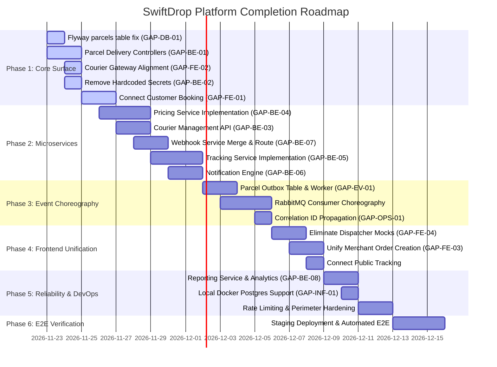

# SwiftDrop — Complete Development & Implementation Roadmap

**Document ID**: SD-AUDIT-09  
**Audit Date**: November 22, 2026  
**Auditor**: Principal Enterprise Architect & DevOps Engineering Director  

---

## 1. Roadmap Architecture & Phase Progression

The roadmap directly addresses the defects and gaps uncovered during the technical audit. It does not treat the project as greenfield; it strictly preserves working services while methodically resolving disconnects.

---

## 2. Phase-by-Phase Technical Specifications

### Phase 1: Critical Core Corrections & API Surface Exposure (P0 Blockers)
* **Primary Objective**: Eliminate critical blockers that prevent courier fulfillment and corrupt clean database migrations.
* **Exact Scope**:
  1. Author `V0__create_parcels_table.sql` in `parcel-service` so `parcel_db` can migrate cleanly from scratch.
  2. Implement `ParcelDeliveryController.java` in `parcel-service` exposing the existing OTP, Cloudinary photo proof, courier assignment, and delivery completion services.
  3. Change `COURIER_DELIVERIES_API_BASE_URL` in frontend to point to Gateway port `8080`.
  4. Strip hardcoded Neon PostgreSQL passwords and connection strings from `application.properties`.
  5. Connect `BookParcel.tsx` and `MyParcels.tsx` to `parcel-service` via API Gateway, removing browser `localStorage` persistence.
* **Reusable Existing Code**:
  - `OtpChallengeService`, `DeliveryPhotoProofService`, `DeliveryCompletionService` in `parcel-service`.
  - `proofOfDeliveryApi.ts` and `deliveries.api.ts` in frontend.
* **Exit Conditions & Acceptance Criteria**:
  - `mvn flyway:migrate` succeeds on a brand-new PostgreSQL database.
  - Couriers can retrieve assigned deliveries, verify OTP, upload delivery photo, and mark parcel delivered via HTTP API.
  - Customer bookings create persistent rows in `parcels` table and appear in Dispatcher unassigned queue.

---

### Phase 2: Skeleton Microservices Implementation & Feature Branch Stabilization (P1)
* **Primary Objective**: Transform skeleton services into working microservices and integrate verified remote branches.
* **Exact Scope**:
  1. **`pricing-service`**:
     - Implement distance matrix and weight tier fee calculation ($Base + W \times Rate$).
     - Expose `POST /api/v1/pricing/calculate`.
     - Add route `/api/v1/pricing/**` in API Gateway.
  2. **`courier-service`**:
     - Implement `CourierManagementController` with `GET /api/v1/couriers/me`, `PUT /api/v1/couriers/me/availability`, and `POST /api/v1/couriers/me/shift`.
     - Author Flyway migration `V1__init_courier_schema.sql`.
  3. **`webhook-service`**:
     - Normalize migrations on branch `feature/merchant-webhooks` to `src/main/resources/db/migration/`.
     - Rebase onto `dev`, verify tests on port 8089, and configure Gateway route `/api/v1/merchant/webhooks/**`.
  4. **`tracking-service`**:
     - Create `tracking_events` read model schema with Flyway.
     - Expose public endpoint `GET /api/v1/tracking/{trackingNumber}`.
     - Add route `/api/v1/tracking/**` in API Gateway.
  5. **`notification-service`**:
     - Implement template rendering engine (Email/SMS).
     - Author database audit table `notifications`.
* **Exit Conditions**: All 5 services compile, migrate their own logical databases, and respond via Gateway proxy routes.

---

### Phase 3: Asynchronous Event Choreography & Transactional Outbox Full Loop (P1)
* **Primary Objective**: Connect event publishers and consumers so business mutations trigger asynchronous cross-service actions.
* **Exact Scope**:
  1. Add `outbox_events` Flyway migration and `OutboxPublisherWorker` in `parcel-service`. Emitting `parcel.PARCEL_CREATED`, `parcel.PARCEL_ASSIGNED`, `parcel.PARCEL_DELIVERED`, `parcel.PARCEL_FAILED`.
  2. Implement `@RabbitListener` consumers:
     - `tracking-service`: Consumes `parcel.*` and `dispatch.*` to update the read projection table in real time.
     - `notification-service`: Consumes `parcel.PARCEL_CREATED` (confirmation email), `parcel.OTP_GENERATED` (SMS to recipient), `merchant.MERCHANT_APPROVED` (approval email with API key).
     - `webhook-service`: Consumes `parcel.*` and pushes signed HMAC payloads (`X-SwiftDrop-Signature`) to registered merchant webhook URLs.
  3. Propagate correlation IDs across all events.
* **Exit Conditions**: Placing an order triggers outbox publication $\rightarrow$ RabbitMQ delivery $\rightarrow$ notification generation $\rightarrow$ tracking update $\rightarrow$ merchant webhook dispatch without synchronous coupling.

---

### Phase 4: Frontend Contract Unification & Mock Elimination (P1)
* **Primary Objective**: Purge all remaining mock data and local state hacks from the frontend application.
* **Exact Scope**:
  1. Replace `MOCK_PARCELS` and `MOCK_COURIERS` in `DispatcherDashboard.tsx`, `DispatcherParcels.tsx`, and `Reports.tsx` with real API calls.
  2. Deprecate `MerchantModuleBoundary` preview lock; integrate `MerchantOrderCreate.tsx` directly with `parcel-service`.
  3. Wire `PublicTracking.tsx` to real `tracking-service` endpoint.
  4. Wire `BulkBooking.tsx` to backend batch parcel creation endpoint.
* **Exit Conditions**: Zero references to `mockData.ts` or `localStorage` in business workflows; `npm run build` passes with zero errors.

---

### Phase 5: Platform Reliability, Security Hardening & Reporting Analytics (P2)
* **Primary Objective**: Harden operational security, provide executive analytics, and enable local offline developer environments.
* **Exact Scope**:
  1. **`reporting-service`**: Implement scheduled daily aggregation calculating delivery success rate, courier turnaround time, and merchant volume metrics.
  2. Implement Bucket4j token bucket rate limiting on API Gateway edge routes.
  3. Add local `postgres:16-alpine` service container to `docker-compose.yml` with automated initialization of all 10 logical databases.
* **Exit Conditions**: Complete local stack can start cleanly with `docker compose up` without external cloud dependencies.

---

### Phase 6: End-to-End Staging Verification & Release Readiness (P3)
* **Primary Objective**: Rigorous automated regression testing, load testing, and production deployment sign-off.
* **Exact Scope**:
  1. Execute automated Newman/Postman and `scripts/e2e-smoke-test.sh` suites against running cluster.
  2. Concurrency stress testing on dispatch proximity algorithm and outbox workers.
  3. Final production documentation and API contract schemas.
