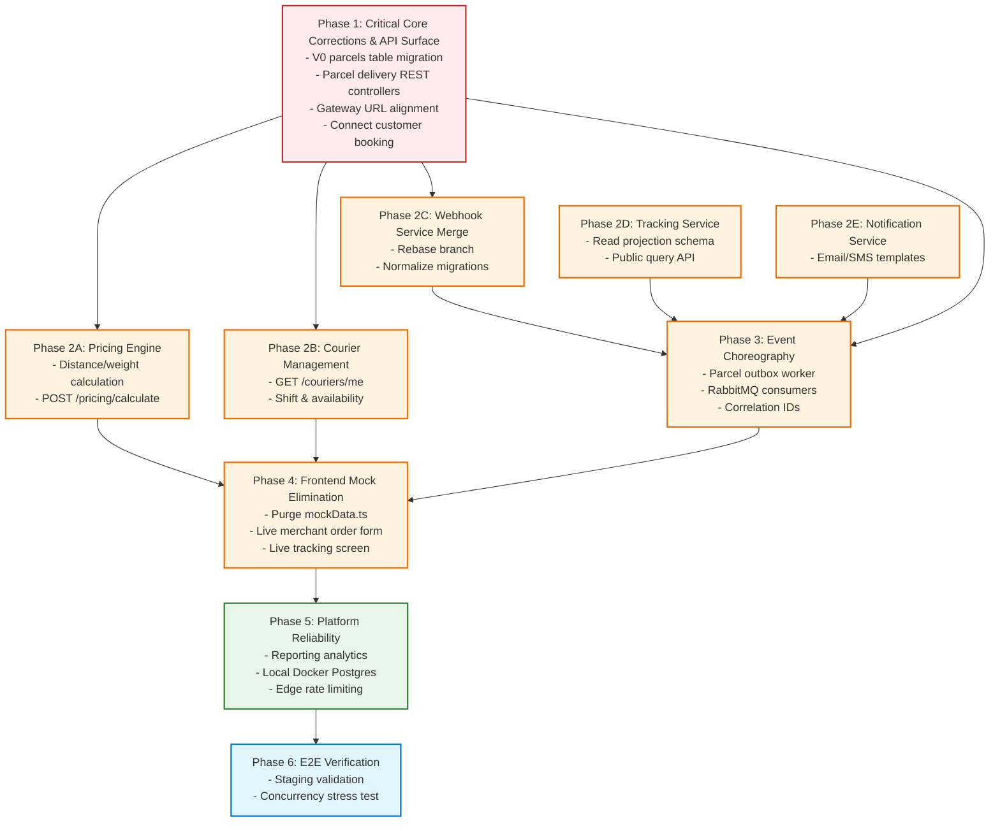
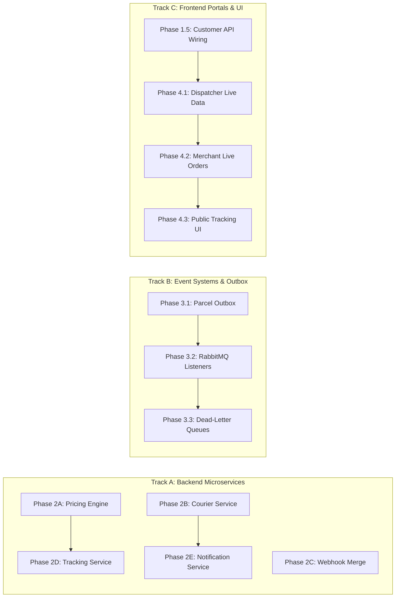

# SwiftDrop — Phase Dependency & Blocker Architecture

**Document ID**: SD-AUDIT-10  
**Audit Date**: November 22, 2026  
**Auditor**: Principal Enterprise Architect  

---

## 1. Cross-Phase Dependency Graph

The execution order is governed strictly by technical prerequisites. No phase may proceed if its prerequisite exit conditions are unmet.

---

## 2. Parallelizable Work Streams

Development can be parallelized across three independent engineering tracks once Phase 1 establishes the baseline:

---

## 3. Service-to-Service Dependency Matrix

| Service | Directly Depends On (Sync REST) | Depends On via RabbitMQ Events | Consumed By |
| :--- | :--- | :--- | :--- |
| **`api-gateway`** | All active microservices | None | Client Browsers, Mobile Apps, Postman |
| **`auth-service`** | None (Independent aggregate) | None | Gateway, All Services (JWT trust) |
| **`parcel-service`** | `courier-service` (ID validation) | None | Gateway, Dispatch, Frontend |
| **`dispatch-service`**| None (Uses local courier cache) | `parcel.PARCEL_CREATED` (Auto-dispatch)| Gateway, Dispatcher Portal |
| **`courier-service`** | None (Independent aggregate) | None | Gateway, Dispatch, Courier Portal |
| **`pricing-service`** | None (Stateless rules) | None | Customer Booking, Merchant Portal |
| **`tracking-service`**| None | `parcel.*`, `dispatch.*` | Public Tracking, Customer Portal |
| **`notification-service`**| None | `parcel.*`, `merchant.*`, `dispatch.*`| End Users (SMS/Email) |
| **`webhook-service`** | None | `parcel.*` | External Merchant Servers |
| **`reporting-service`**| None | `parcel.*`, `dispatch.*` | Dispatcher & Executive Dashboards |

---

## 4. The Critical Path to Full Platform Completion

The **Critical Path** (the longest sequence of dependent activities) is:
1. **`GAP-DB-01` & `GAP-BE-01`**: Provision base parcels table & expose Parcel Delivery Controllers (2 days).
2. **`GAP-BE-04`**: Implement Pricing Engine (3 days).
3. **`GAP-EV-01`**: Implement Parcel Outbox & RabbitMQ Consumer Choreography (4 days).
4. **`GAP-FE-01` & `GAP-FE-04`**: Wire Customer Booking, Dispatcher, and Tracking UIs to live APIs (3 days).
5. **Phase 5 & 6**: Local Docker Compose multi-database stack & E2E verification (3 days).

**Total Estimated Critical Path Duration**: **15 working days**.
