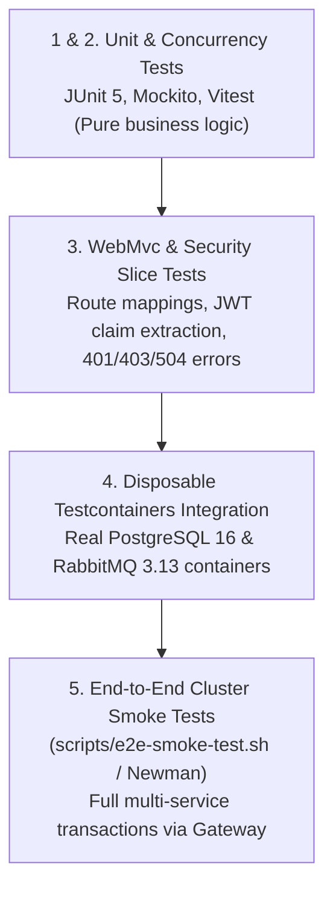

# SwiftDrop — Acceptance & Quality Assurance Strategy

**Document ID**: SD-AUDIT-11  
**Audit Date**: November 22, 2026  
**Auditor**: Principal QA Architect & Release Engineering Lead  

---

## 1. Testing Pyramid & Verification Architecture

SwiftDrop implements a rigorous multi-tiered verification strategy designed to guarantee production stability across distributed microservice boundaries:

---

## 2. Testing Levels & Tooling Matrix

| Test Level | Tooling / Framework | Scope & Focus | Execution Trigger | Quality Gate Threshold |
| :--- | :--- | :--- | :--- | :--- |
| **Unit Testing** | JUnit 5, Mockito, Vitest | Domain entities, algorithms (Haversine), validators, React hooks | Every build / commit | 100% PASS, 0 Failures |
| **Security Slice** | `@WebMvcTest`, Spring Security Test | Role authorization, header stripping, token validation | Maven test phase | 100% PASS |
| **Migration Testing**| Flyway Test Harness | Clean DDL execution, constraint enforcement, rollback sanity | CI pipeline | 100% PASS on blank DB |
| **PostgreSQL Integration** | Testcontainers (`org.testcontainers:postgresql`) | `SELECT FOR UPDATE`, JSONB, partial indexes, real transactions | Nightly / Release CI | 100% PASS (Zero H2 shortcuts) |
| **Messaging Integration** | Testcontainers (`org.testcontainers:rabbitmq`) | Outbox polling, exchange delivery, consumer idempotency | Nightly / Release CI | 100% PASS |
| **E2E Gateway Smoke** | Bash + `curl` (`scripts/e2e-smoke-test.sh`) | Live container cluster health, RBAC rejection, auto-dispatch | Post-deployment | Zero FAIL outcomes |

---

## 3. Strict Development & Verification Rules

1. **The H2 Invalidation Rule**:
   - A passing test on H2 database **does NOT prove PostgreSQL compatibility**.
   - Any pull request modifying database migrations or persistence entities must pass verification on a real PostgreSQL dialect instance (via Testcontainers or local Docker PostgreSQL).
2. **Deterministic Java 21 Standard**:
   - All backend microservices must build and pass tests under **Java 21** (`class file version 65.0`).
   - Using Java 17 runtimes with Java 21 bytecodes will result in immediate build termination.
3. **Frontend Zero-Warning Standard**:
   - `npm run lint` (`oxlint`) must return **0 errors**.
   - React Compiler purity rules (no `new Date()` or synchronous `setState` in render or effect bodies) must be strictly maintained.
   - `npm run build` must compile cleanly without TypeScript errors.
4. **Idempotent Outbox & Consumer Rule**:
   - Every RabbitMQ message consumer must be idempotent.
   - Duplicate message deliveries must be safely discarded using message deduplication tables or atomic state checks (`WHERE status = 'EXPECTED'`).

---

## 4. Acceptance Criteria per Implementation Phase

### Phase 1 Quality Gate:
* `V0__create_parcels_table.sql` runs cleanly on blank PostgreSQL.
* `ParcelDeliveryControllerTest` achieves 100% pass on OTP generation, OTP verification, photo proof upload, and two-phase delivery completion.
* `scripts/e2e-smoke-test.sh` reports 0 failures on unauthenticated and tampered token tests.

### Phase 2 Quality Gate:
* All 5 skeleton services (`pricing`, `courier`, `webhook`, `tracking`, `notification`) compile, start up, and expose health endpoints on designated ports (8083, 8086, 8087, 8088, 8089).
* Gateway proxies each service with validated timeouts.

### Phase 3 Quality Gate:
* Placing a parcel order creates an outbox row $\rightarrow$ published to RabbitMQ $\rightarrow$ consumed by Notification and Tracking services without message loss.
* Simulated RabbitMQ broker downtime suspends outbox polling without data loss and recovers automatically upon reconnection.

### Phase 4 Quality Gate:
* Zero instances of `localStorage` or `MOCK_PARCELS` in `src/features/`.
* Complete customer order flow verified from React UI through Gateway to `parcel_db`.
